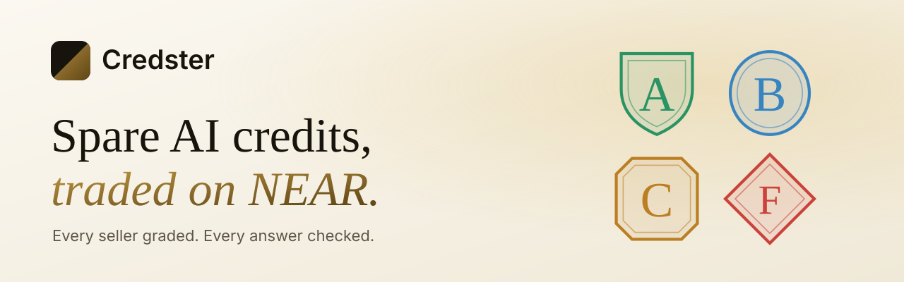
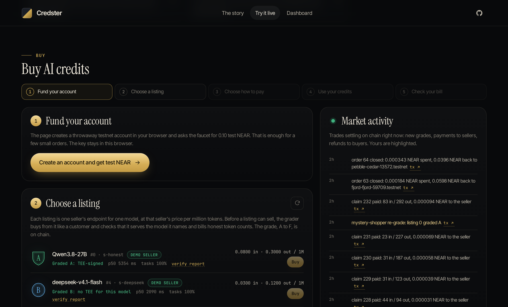
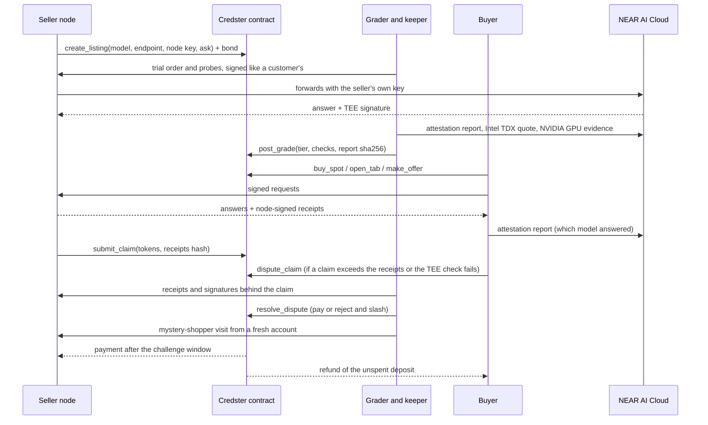

<div align="center">

<picture>
  <source media="(prefers-color-scheme: dark)" srcset="assets/banner-dark.svg">
  
</picture>

**[Live market](https://credster.store)** · [How it works](#how-it-works) · [Try it](#try-it) · [Why you can trust a grade](#why-you-can-trust-a-grade) · [How NEAR is used](#how-near-is-used) · [Known limits](#known-limits)


</div>

Credster is a market on NEAR for spare AI inference credits. Sellers list a model and a price. Buyers pay at the seller's ask, run a pay-as-you-go tab or bargain with the seller's agent. Before a listing can sell, a grader checks that it serves the model it names and bills honest token counts, so a buyer gets what it paid for.

Built at NEAR HACKATHON (Nov 1 to 14, 2026). It fits the Agent Economy, AI Security and AI Swarms tracks.

**Open it:** [credster.store](https://credster.store) is the live market on NEAR testnet. A mirror of the landing page is at [credster.vercel.app](https://credster.vercel.app). The launch post and film are on [X](https://x.com/zkasuran/status/2121211478409969755).



## Two ways in

| | Buy | Sell |
| --- | --- | --- |
| You are | a person or an agent that needs inference | someone with credits or GPU time to spare |
| You do | get test NEAR in one click, choose a graded listing, pay at the ask or bargain, chat, then check your bill against your own receipts | run a seller node in front of your own AI account, list a model, set a price and post a 0.2 NEAR bond |
| You get | the model you chose, with a signed receipt for every answer | paid per answer, after a 60 second window, straight from the contract |
| Start | [credster.store/live.html](https://credster.store/live.html) | [JUDGING.md](JUDGING.md#running-the-live-server) or `node src/cli.js seller-list` |

## How it works

1. **List.** A seller lists a model, an OpenAI-compatible endpoint and a price. It also posts a NEAR bond. The seller's own upstream key stays on the seller's node (`node/src/seller-node.js`). Buyers never see it.
2. **Get graded.** The grader buys a small order like any customer and checks the endpoint. A grade from A to F goes on chain with the hash of its full report. An F suspends the listing. Only fresh, passing grades can sell.
3. **Trade.** A buyer pays one of three ways.
4. **Settle.** The seller node signs a receipt for every answer and claims batches on chain. The buyer has a 60 second window to dispute. After it, the contract pays the seller and refunds the unused deposit.

| Way to buy | How the price is set | Your money |
| --- | --- | --- |
| Spot | the seller's ask at the moment you buy, locked for that order | a deposit held by the contract, the unused part refunded |
| Tab | the seller's ask at each claim, never above the ceiling you set | the same |
| Bargain | up to four moves between your agent and the seller's agent, each with its reasoning on chain | the deposit is escrowed with the offer |

Market rules in full: [docs/RULES.md](docs/RULES.md).

## Why you can trust a grade

Reselling AI credits has two risks a buyer cannot see: a cheaper model behind an expensive name and token counts that run high. Credster checks both with evidence anyone can re-run.

| Check | What it shows | Code |
| --- | --- | --- |
| Token-count fingerprint | The prompt token count matches the claimed model's tokenizer. Counts scaled by one factor mean inflated billing. Reference counts are measured at NEAR AI during each grade. | `node/src/grader.js` |
| TEE signature | NEAR AI's enclave signed this exact request and answer and named the model that ran. A signature that names another model proves a swap. | `node/src/tee.js` |
| Hardware attestation | The signer lives in genuine, up-to-date Intel TDX hardware with attested NVIDIA GPUs. The grader verifies the quote against Intel's collateral and NVIDIA's signed verdict itself. | `node/src/attest.js` |
| Fresh tasks | Random checkable tasks answered right, plus speed and error rate. | `node/src/probes.js` |
| Every answer, in your browser | For TEE models, your page checks each reply's signature and shows which model answered. A wrong model disputes the seller's claim on its own. | `web/site/js/tee.js` |
| Mystery shoppers | Every 2 to 4 hours the keeper re-grades each listing from a fresh account as an ordinary customer order, with natural requests in the live page's own shape, paced like a person. | `node/src/shopper.js` |
| Proof for disputes | The seller must show node-signed receipts that cover its claim and, for TEE models, NEAR AI's signature on every answer. Otherwise the claim is rejected and its bond pays the buyer. | `node/src/grader.js` |

## What a recorded run showed

One end-to-end run on testnet, `scripts/demo.mjs`, on 2026-11-12 against `market.credster-68480.testnet`. Six sellers, each a sub-account with its own node, all with NEAR AI Cloud as upstream. Every transaction hash is in [evidence/run-2026-11-12T07-50-17/](evidence/run-2026-11-12T07-50-17/). Each grade report is in [web/reports/](web/reports/).

| Seller (listing) | Claims | Actually serves | Fingerprint | TEE signature | Grade |
| --- | --- | --- | --- | --- | --- |
| honest (#6) | Qwen3.8-27B | Qwen3.8-27B | match | verified | **A** |
| swap (#7) | Qwen3.8-27B | Qwen3.6-35B-A3B | matches Qwen3.6-35B-A3B | names Qwen3.6-35B-A3B | **F** |
| sibling (#8) | Qwen3.8-27B | Qwen3.8-27B-abliterated | match (same tokenizer) | names the abliterated model | **F** |
| inflate (#9) | glm-5.3-flash | glm-5.3-flash, usage x1.35 | scaled x1.353 | does not match: the answer was rewritten | **F** |
| deepseek (#10) | deepseek-v4.1-flash | deepseek-v4.1-flash | match | not offered for this model | **B** |
| overclaim (#11) | glm-5.3-flash | glm-5.3-flash | match | verified | **A** |

Trading in the same run:

| Step | What happened on chain |
| --- | --- |
| Spot | Alice bought a 0.1 NEAR order at the ask. The seller then raised its ask from 0.08/0.30 to 0.088/0.33 NEAR per 1M tokens. Her order kept the old price. |
| Tab | Bob's tab was priced at the ask (0.12) until the seller raised it to 0.30, then at his ceiling (0.15). |
| Bargain | Bob's agent opened at 0.2376 per 1M output, the seller's agent countered at 0.2838 and Bob accepted in 2 moves. Alice's agent walked away after 4 moves with her deposit refunded. |
| Overclaim | Seller #11 served 34 in / 254 out tokens and claimed 102 / 762. Alice's page found the gap and disputed. The grader rejected the claim and 0.01 NEAR of the seller's bond went to her. |
| Settlement | After the window, 7 claims were paid (0.0013 NEAR) and 10 orders closed with 0.5787 NEAR refunded. |

The live market has since run real shopper visits that caught a bait-and-switch seller. It also produced a false grade caused by a provider-side change that is now fixed. Both are written up in [evidence/live-2026-11-12-tee-and-mystery-shopper/](evidence/live-2026-11-12-tee-and-mystery-shopper/NOTE.md) and [evidence/live-2026-11-13-paced-shoppers/](evidence/live-2026-11-13-paced-shoppers/NOTE.md).


## Try it

### Live, in the browser (3 minutes)

Open [credster.store/live.html](https://credster.store/live.html). The page creates a throwaway testnet account in your browser and funds it from a faucet. Then you can:

- buy from a graded seller (spot, tab or bargaining with the seller's agent) and chat with it;
- check each answer's node-signed receipt and TEE signature in your browser;
- start a demo seller that cuts corners and watch the grader and the shoppers deal with it;
- read the whole market, including every grade report and its hash check, on the [dashboard](https://credster.store/market.html).

The same market works from the CLI (`node src/cli.js help`). [JUDGING.md](JUDGING.md) has the walkthrough, selling with your own NEAR AI Cloud key and how to run the live server.

### Without any key (2 minutes)

1. `cd node && npm install && npm test`: 28 tests (fingerprint rules, tiers, receipts, request signatures, TEE verdicts against a real NEAR AI signature, the shopper's visit plan, price math).
2. `cd contract && cargo test`: 24 tests of the market rules (grading gates, spot, tab ceilings, bargaining limits, disputes and slashing, refunds, unpaid probe usage on F listings).
3. `cd node && TS_CONTRACT=market.credster-68480.testnet node src/cli.js verify-reports`: reads all 12 grades from the recorded contract and checks that each report in `web/reports/` hashes to the `report_hash` on chain.
4. `python3 -m http.server -d web 8080`, then open http://127.0.0.1:8080/market.html?contract=market.credster-68480.testnet. The dashboard reads the contract straight from NEAR RPC. Open a suspended listing and click **grade report**: the page hashes the report in your browser and shows whether it matches the chain.

### Full run on your own testnet deployment

Needs Node 22, Rust with `wasm32-unknown-unknown`, `cargo-near`, the `near` CLI (near-cli-rs) and a NEAR AI Cloud API key (https://cloud.near.ai). A run spends well under $0.10 of NEAR AI credit.

```sh
bash scripts/setup-testnet.sh          # faucet account, 10 sub-accounts, contract; writes .env
(cd node && npm install)
export NEARAI_API_KEY=...              # never commit it
set -a; . ./.env; set +a
node scripts/demo.mjs                  # about 10 minutes
```

You should see the six grades above, the bargaining moves, one rejected claim and the slash, then refunds. Each run writes `evidence/run-<time>/`. Node and order keys go to a throwaway directory under `/tmp`, never into the repository.

### Sell or buy from the CLI

```sh
cd node
# seller: create the listing (generates the node key), then serve
node src/cli.js seller-list --name mynode --seller you.testnet --model Qwen/Qwen3.8-27B \
  --endpoint https://your-host/v1 --ask-in 0.08 --ask-out 0.30 --bond 0.2
TS_UPSTREAM_KEY=... node src/cli.js seller-serve --name mynode --port 8701
# grader
node src/cli.js grade --listing 0 --grader grader.you.testnet
# buyer
node src/cli.js buy-spot --buyer me.testnet --listing 0 --deposit 0.1
node src/cli.js chat --buyer me.testnet --order 0 --prompt "hello"
node src/cli.js audit --buyer me.testnet --order 0 --dispute
```

## How NEAR is used

- **Contract escrow and rules** (`contract/`, near-sdk 5.30): bonds, deposits, offers, the grade gates, claims with a challenge window, disputes, slashing and refunds, with NEP-297 style `EVENT_JSON` logs for every state change.
- **Sub-accounts as identities:** every seller, buyer and the grader is a sub-account of one parent, so each action traces to one agent.
- **Per-order ed25519 keys:** the buyer registers a fresh key on each order and signs every request with it. A leaked order key can spend only that order's remaining budget at that order's price.
- **NEAR AI Cloud:** the upstream for the demo sellers, the source of reference token counts and the source of the TEE signatures and attestation reports that the grader and your browser check.
- **Agents that negotiate** (`node/src/agents.js`): the buyer agent plans a price from the grade (90% of ask for A, 80% for B), opens lower, counters once with its reasoning, then accepts or walks away. The seller agent keeps a private floor. Rules set every price. An optional LLM (`TS_LLM_NOTES=1`) only writes the note, so text in a counterparty's note cannot move money.

## Architecture



## Known limits

- **The grader is one trusted account.** Its reports are public and hash-bound. Anyone can rerun a grade with `node src/cli.js grade --no-post`. The contract only accepts grades and dispute decisions from the grader, though. A grader in a TEE (or several graders with a quorum) is not built.
- **Without TEE signatures, grading rests on token counts and tasks.** For models NEAR AI does not serve in a TEE (DeepSeek here), a seller could swap in a sibling with the same tokenizer or rewrite `usage`. Four tasks would not notice. Such listings top out at grade B.
- **The software image is recorded, not pinned.** The grader verifies the Intel TDX and NVIDIA evidence behind each signer and records the VM measurements. It keeps no list of approved images, so it cannot tell NEAR AI's intended serving code from other code in a genuine enclave.
- **Shoppers are hidden, not invisible.** Their requests come from the grader's server address. The public faucet funds about one shopper account an hour. A grade lands on chain right after a visit, so a seller can tell afterwards which order it was.
- **Testnet NEAR, no streaming.** No stablecoin and no NEAR Intents yet (Intents has no testnet). The seller node refuses `stream: true`.
- **The sellers are mine.** Every seller on the live market is a persona I run against one NEAR AI account. It shows the mechanism end to end. It does not measure grading accuracy on outside sellers.
- **Provider terms.** Many AI providers forbid reselling API access. A seller answers for its own provider's terms. Self-hosted open models are the clean case.

## Repository

| Path | What |
| --- | --- |
| `contract/` | Rust contract and its 24 unit tests |
| `node/src/seller-node.js` | OpenAI-compatible seller gateway, receipts, claims |
| `node/src/grader.js`, `tee.js`, `attest.js`, `probes.js`, `shopper.js` | grading, signature and hardware checks, probe texts, the mystery shopper's visit |
| `node/src/buyer.js`, `agents.js` | buyer client (orders, signed calls, receipt audit, disputes) and the bargaining agents |
| `node/src/live.js`, `keeper.js` | live server: website, hosted seller nodes, faucet; the keeper that grades, settles and runs shopper visits |
| `node/fingerprints.json` | fallback reference token counts measured from NEAR AI Cloud |
| `web/index.html`, `live.html`, `market.html`, `site/` | landing page, in-browser trading and the dashboard that reads the contract from NEAR RPC |
| `web/reports/` | the published grade reports |
| `scripts/` | `setup-testnet.sh`, `go-live.mjs`, `demo.mjs`, `cleanup.mjs`, `shoot.py` |
| `evidence/` | the recorded run and the live runs, with every transaction hash |
| `docs/RULES.md`, `JUDGING.md`, `Dockerfile` | market rules, the guide for judges, the live server image |

## Disclosures

- **Libraries:** near-sdk, near-api-js, @noble/curves, @noble/hashes, @phala/dcap-qvl and Playwright (screenshots only). The site vendors GSAP 3.15 with ScrollTrigger and SplitText (GSAP standard no-charge license), Lenis 1.3 (MIT), @noble/ed25519 and @noble/curves with @noble/hashes for in-browser signing (MIT) and the fonts Instrument Serif, Inter Tight and JetBrains Mono (SIL OFL) in `web/site/`.
- **AI assistance:** the code and docs were written with an AI coding agent, directed and reviewed by the author.
- **Generated media:** the landing page's photographs were made with Gemini 3 Pro Image and GPT Image 2.5 and its video loops with Kling 3.0 image-to-video, all through GMI Cloud. They are illustrations. Every number on the page comes from the testnet runs or from live RPC.

License: MIT.
