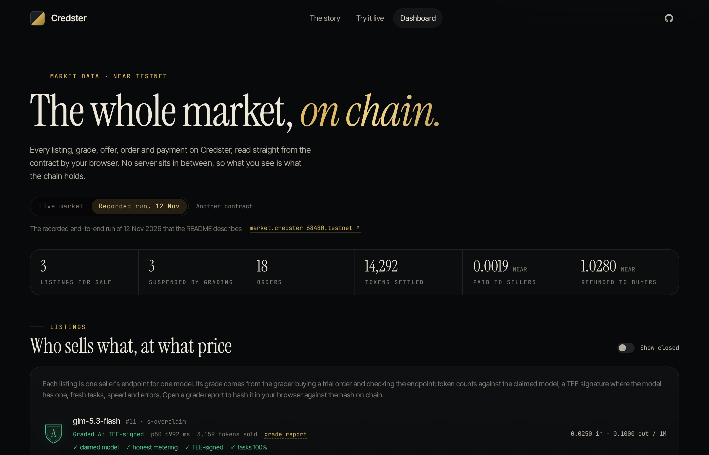
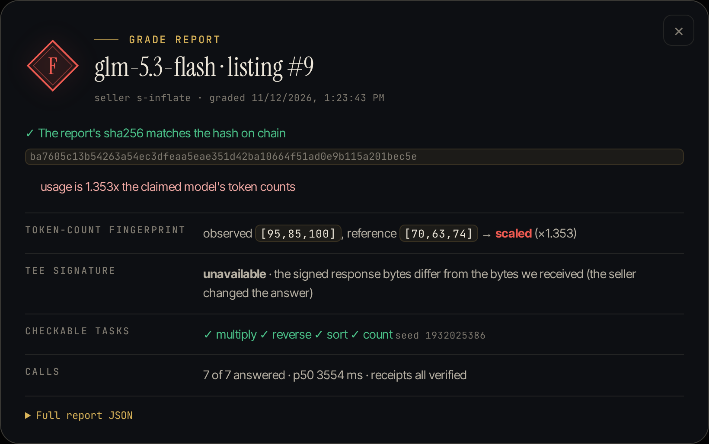
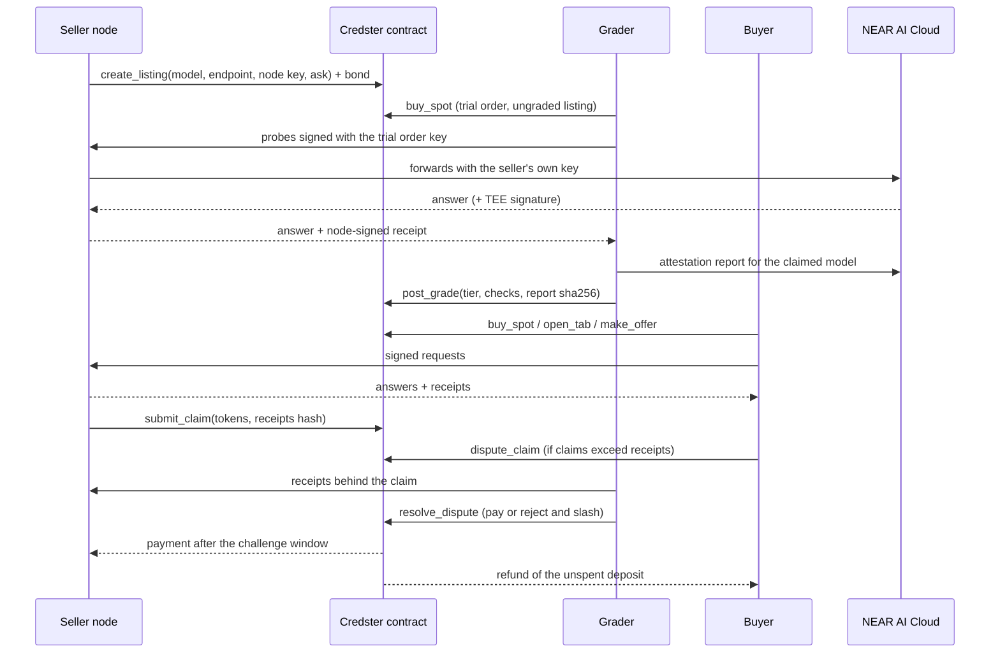

# Credster

Credster is a market on NEAR where people and agents sell AI inference credits and buy them three ways: at the spot price, by bargaining or on a pay-as-you-go tab. Every seller endpoint is graded before it can trade. The grade answers the two questions a buyer of resold AI credits cannot check alone: **is this the model the seller claims** and **are the token counts honest**.

Built at NEAR HACKATHON (Nov 1 to 14, 2026). Suggested tracks: `agents`, `security`, `swarms`. Everything here was written during the hackathon window.



## The problem

People hold AI credits they do not use: a team plan, a NEAR AI Cloud balance, spare capacity on their own GPU. Agents need inference and would happily buy it below list price. Reselling already happens, but the buyer takes two risks it cannot see:

- **Model substitution.** The endpoint says `Qwen3.8-27B` and serves a cheaper model or an uncensored ("abliterated") copy of the same model. The `model` field in the response is whatever the seller writes there.
- **Inflated metering.** The endpoint serves the right model and reports 35% more tokens than it used.

Escrow and spending limits do not help here. The buyer pays exactly what was agreed, for something other than what was agreed.

## What Credster does

1. A seller lists a model, an OpenAI-compatible endpoint and a price. It also posts a NEAR bond. The seller's own upstream key stays on the seller's node (`node/src/seller-node.js`); buyers never see it.
2. The grader buys a small trial order like any buyer and probes the endpoint (`node/src/grader.js`):
   - **Token-count fingerprint.** Three fixed probe texts. The prompt token count depends on the model's tokenizer and chat template, so it is a fingerprint. Measured against NEAR AI Cloud directly, the counts were identical on repeat calls and differed between model families (`node/fingerprints.json`). A mismatch means a different model; counts that are all the reference times one factor mean inflated billing.
   - **TEE signature.** For models NEAR AI Cloud serves in a TEE, the seller node relays the provider's signature for one probe. The grader checks that the signed text is `<claimed model>:sha256(our request):sha256(our response)` and that it recovers to a signing address in NEAR AI's public attestation report for that model. A valid signature that names a different model is proof of substitution.
   - **Fresh checkable tasks** (multiplication, string reversal, sorting, counting) generated from a random seed each run, plus latency and error rate.
3. The grade (A, B, C or F) goes on chain with the sha256 of the full JSON report. The contract enforces the rules: a passing tier needs the fingerprint and metering checks, tier A needs the TEE check and F suspends the listing. Only fresh, passing grades can trade.
4. Buyers sign each request with a per-order key. The seller node signs a usage receipt for each answer and claims batches on chain. The buyer has a challenge window to dispute. The grader checks the receipts behind a disputed claim; a claim the receipts do not cover is rejected and the seller's bond is slashed to the buyer.

Market rules in full: [docs/RULES.md](docs/RULES.md).

## Measured on NEAR testnet

One end-to-end run, `scripts/demo.mjs`, on 2026-11-12 at 07:50 UTC against contract `market.credster-68480.testnet`. Six sellers, each a sub-account with its own node. Upstream for all six is NEAR AI Cloud. Evidence: [evidence/run-2026-11-12T07-50-17/](evidence/run-2026-11-12T07-50-17/) (`run.log`, `summary.json` with every transaction hash) and the grade reports in [web/reports/](web/reports/).

**Grading.** One trial order per seller, 7 probe calls each. Each grade's report sha256 is on chain; `node src/cli.js verify-reports` re-checks all of them without any key.

| Seller (listing) | Claims | Actually serves | Fingerprint | TEE signature | Grade |
| --- | --- | --- | --- | --- | --- |
| honest (#6) | Qwen3.8-27B | Qwen3.8-27B | match | verified | **A** |
| swap (#7) | Qwen3.8-27B | Qwen3.6-35B-A3B | mismatch, matches Qwen3.6-35B-A3B | names Qwen3.6-35B-A3B | **F** |
| sibling (#8) | Qwen3.8-27B | Qwen3.8-27B-abliterated | match (same tokenizer) | names the abliterated model | **F** |
| inflate (#9) | glm-5.3-flash | glm-5.3-flash, usage x1.35 | scaled x1.353 | no match: the seller rewrote the answer | **F** |
| deepseek (#10) | deepseek-v4.1-flash | deepseek-v4.1-flash | match | not offered for this model | **B** |
| overclaim (#11) | glm-5.3-flash | glm-5.3-flash | match | verified | **A** (cheats later, see below) |

The three F listings were suspended. Buying from them was refused (`listing graded F`). The contract also paid nothing for the grader's probe calls on them (orders 9, 10 and 11 closed with 0 spent).

**Trading.**

| Step | What happened on chain |
| --- | --- |
| Spot | Alice bought a 0.1 NEAR order on #6 at the ask. The seller's pricing rule then raised the ask from 0.08/0.30 to 0.088/0.33 NEAR per 1M; her order kept the old price. |
| On-demand tab | Bob opened a tab on #10 with an output ceiling of 0.15. The first claim was priced at the ask (0.12); after the seller raised the ask to 0.30, the next claim was priced at the ceiling (0.15). |
| Bargain, tier A | Bob's agent opened at 0.2376 per 1M output. The seller's agent countered at 0.2838 and Bob accepted (2 moves). The negotiated order was used and paid. |
| Bargain, tier B | Alice's agent and the seller's agent exchanged 4 moves (0.192, 0.255, 0.240, 0.255). The counter stayed above her plan, so she walked away and the 0.03 NEAR deposit was refunded. |
| Overclaim | Seller #11 served 34 input / 254 output tokens to Alice (two signed receipts) and claimed 102 / 762. Alice's client found the gap and disputed. The seller's own receipts summed to 34 / 254, so the grader rejected the claim and 0.01 NEAR of the seller's bond went to Alice. |
| Settlement | After the 60 s challenge window, 7 claims were paid (0.001313732 NEAR in total) and 10 orders closed with the unspent deposits refunded (0.5787 NEAR). |

## Try it

### Without any key (2 minutes)

1. `cd node && npm install && npm test`: 19 tests (fingerprint rules, tiers, receipts, request signatures, EIP-191 recovery of a real NEAR AI signature, price math).
2. `cd contract && cargo test`: 24 tests of the market rules (grading gates, spot, tab ceilings, bargaining limits, disputes and slashing, refunds, unpaid probe usage on F listings).
3. `cd node && TS_CONTRACT=market.credster-68480.testnet node src/cli.js verify-reports`: reads all 12 grades from the testnet contract and checks that each report file in `web/reports/` hashes to the `report_hash` on chain.
4. `python3 -m http.server -d web 8080`, open http://127.0.0.1:8080/market.html for the dashboard. It reads the testnet contract straight from NEAR RPC. Click **grade report** on an F listing: the page downloads the report, hashes it in the browser and shows whether it matches the `report_hash` on chain. http://127.0.0.1:8080 is the landing page; its **Verify all reports** button runs the same check for all 12 grades.



### Full run on your own testnet deployment

Needs Node 22, Rust with `wasm32-unknown-unknown`, `cargo-near`, `near` CLI (near-cli-rs) and a NEAR AI Cloud API key (https://cloud.near.ai). The run spends well under $0.10 of NEAR AI credit.

```sh
bash scripts/setup-testnet.sh          # faucet account, 10 sub-accounts, contract; writes .env
(cd node && npm install)
export NEARAI_API_KEY=...              # never commit it
set -a; . ./.env; set +a
node scripts/demo.mjs                  # about 10 minutes
```

You should see the six grades above, the bargaining moves, one rejected claim and the slash, then refunds. Each run writes `evidence/run-<time>/`. Node and order keys go to a throwaway directory under `/tmp`, never into the repository.

### Use it as a seller or buyer

```sh
cd node
# seller: create the listing (generates the node key), then serve
node src/cli.js seller-list --name mynode --seller you.testnet --model Qwen/Qwen3.8-27B \
  --endpoint https://your-host/v1 --ask-in 0.08 --ask-out 0.30 --bond 0.2
TS_UPSTREAM_KEY=... node src/cli.js seller-serve --name mynode --port 8701
# grader
node src/cli.js grade --listing 0 --grader grader.you.testnet
# buyer
node src/cli.js buy-spot --buyer me.testnet --listing 0 --deposit 0.1
node src/cli.js chat --buyer me.testnet --order 0 --prompt "hello"
node src/cli.js audit --buyer me.testnet --order 0 --dispute
```

## How NEAR is used

- **Contract escrow and rules** (`contract/`, near-sdk 5.30): bonds, deposits, offers, the grade gates, claims with a challenge window, disputes, slashing and refunds. NEP-297 style `EVENT_JSON` logs for every state change.
- **Sub-accounts as identities**: every seller, buyer and the grader is a sub-account of one parent, so each action traces to one agent.
- **Per-order ed25519 keys**: the buyer registers a fresh key on each order and signs gateway requests with it. A leaked order key can spend only that order's remaining budget at that order's price.
- **NEAR AI Cloud**: the upstream for the demo sellers, the reference for fingerprints and the source of the TEE signatures and attestation reports the grader checks.
- **Agents that negotiate**: `node/src/agents.js`. The buyer agent plans a price from the grade (90% of ask for A, 80% for B), opens lower, counters once with its reasoning, then accepts or walks away. The seller agent keeps a private floor. Rules set every price; an optional LLM (`TS_LLM_NOTES=1`) only writes the note, so text in a counterparty's note cannot move money.

## Architecture



## What does not work yet and what I did not check

- **The grader is one trusted account.** Its reports are public and hash-bound. Anyone can rerun `node src/cli.js grade --no-post`, but the contract trusts the grader's account. Running the grader in a TEE or as several graders with a quorum is not built.
- **The fingerprint identifies a tokenizer family, not a model.** Siblings that share a tokenizer give identical counts: `z-ai/glm-5.3` with `z-ai/glm-5.3-flash`. So do `Qwen3.8-27B` and its abliterated copy. The TEE check separates the Qwen pair in the run above. For models without TEE signatures, a same-tokenizer swap is caught only if the checkable tasks expose it. With four tasks they usually will not.
- **A careful cheater can fake the counts.** A seller that serves another model and rewrites `usage` to the claimed tokenizer's counts passes the fingerprint. For TEE models the signature still catches it; for others it does not.
- **A seller can refuse to relay TEE signatures.** For a model that has TEE signatures at the provider, Credster then caps the grade at C rather than failing it.
- **I did not verify the Intel TDX and NVIDIA quotes myself.** The grader trusts the signing address that NEAR AI's public attestation report lists for a model.
- **Probes can be recognised.** The grader uses its own account. A seller that answers the grader honestly and cheats everyone else is caught only by buyers' disputes over metering, not over substitution. Rotating grader sub-accounts would make this harder; it is not built.
- **No streaming.** The seller node refuses `stream: true`.
- **Native testnet NEAR only.** No stablecoin and no NEAR Intents. Intents has no testnet. Paying a deposit from another chain through Intents is the obvious next step.
- **Small test.** One run, six sellers, all sellers are personas run by me against one NEAR AI Cloud account, `127.0.0.1` endpoints. This shows the mechanism works end to end; it is not a benchmark of grading accuracy.
- **Provider terms.** Many AI providers forbid reselling API access. A seller is responsible for its own provider's terms. Self-hosted open models are the clean case.

## Repository

| Path | What |
| --- | --- |
| `contract/` | Rust contract and its 24 unit tests |
| `node/src/seller-node.js` | OpenAI-compatible seller gateway, receipts, claims |
| `node/src/grader.js` | grading engine and dispute resolution |
| `node/src/buyer.js` | buyer client: orders, signed calls, receipt audit, disputes |
| `node/src/agents.js` | bargaining and pricing agents |
| `node/fingerprints.json` | reference token counts measured from NEAR AI Cloud |
| `web/index.html`, `web/site/` | landing page: the testnet run, live stats and in-browser report verification |
| `web/market.html` | static dashboard of listings, offers, orders and claims |
| `web/reports/` | the published grade reports |
| `scripts/` | `setup-testnet.sh`, `demo.mjs`, `cleanup.mjs`, `shoot.py` |
| `docs/RULES.md`, `docs/DEDUPE.md` | market rules; comparison with the other 649 submissions |

## Disclosures

- **Libraries:** near-sdk, near-api-js, @noble/curves, @noble/hashes, Playwright (screenshots only). The landing page vendors GSAP 3.15 with ScrollTrigger and SplitText (GSAP standard no-charge license), Lenis 1.3 (MIT) and the fonts Instrument Serif, Inter Tight and JetBrains Mono (SIL OFL) in `web/site/`.
- **AI assistance:** the code and docs were written with an AI coding agent, directed and reviewed by the author.
- **Generated media:** the landing page's photographs were made with Gemini 3 Pro Image and GPT Image 2.5, and its video loops with Kling 3.0 image-to-video, all through GMI Cloud. They are illustrations; every number on the page comes from the testnet run or from live RPC.

License: MIT.
